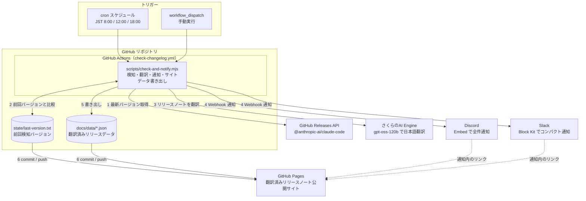
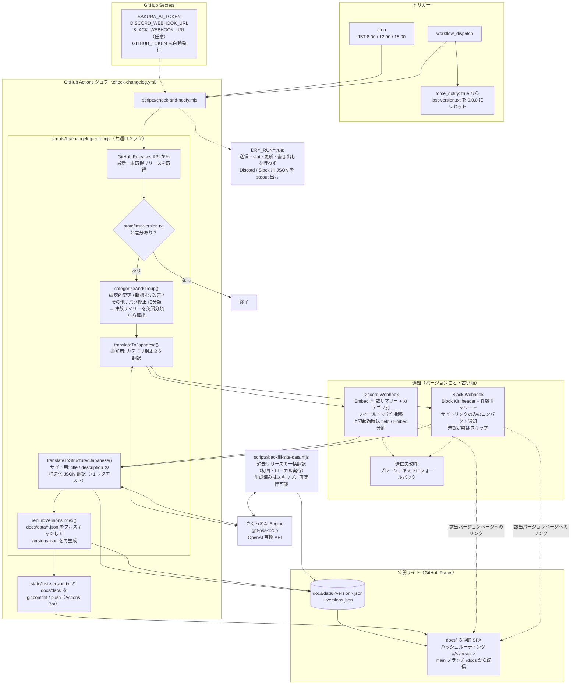

# アーキテクチャ構成図

Claude Code の新バージョンを検知し、リリースノートを日本語翻訳して Discord / Slack に通知し、GitHub Pages で公開するまでの構成をまとめたドキュメント。

- 画像（SVG）版: [概要図](assets/architecture-overview.svg) / [詳細図](assets/architecture-detail.svg)
- HTML 版（ダークテーマ対応・ブラウザで直接開く）: [assets/architecture.html](assets/architecture.html)

> **図の正本は本ファイルの Mermaid** とし、SVG / HTML は閲覧用の派生物として扱う。処理フローを変更したら、まず Mermaid を更新し、続けて SVG / HTML も合わせて更新すること。

## 概要図

GitHub Actions のスケジュール実行を起点に、外部サービスとどう連携するかの全体像。

処理の流れ:

1. 毎日 JST 8:00 / 12:00 / 18:00 の cron（または手動実行）で GitHub Actions が起動
2. GitHub Releases API から最新バージョンを取得し、`state/last-version.txt` と比較
3. 新バージョンがあれば、さくらのAI Engine（gpt-oss-120b）でリリースノートを日本語翻訳
4. Discord（Embed・全件掲載）と Slack（Block Kit・サマリーのみ）へ Webhook 通知
5. サイト用の翻訳データを `docs/data/` に書き出し
6. state とサイトデータを commit / push すると、main ブランチの `/docs` を配信する GitHub Pages に自動反映。通知には公開サイトの該当バージョンページへのリンクを掲載

## 詳細図

分類・翻訳の2系統、フォールバック、`DRY_RUN` / `force_notify`、バックフィルまで含めた詳細フロー。

補足:

- **翻訳は2系統**: 通知用の行翻訳（`translateToJapanese()`）とサイト用の構造化翻訳（`translateToStructuredJapanese()`）は別リクエスト。件数サマリーは翻訳前の英語分類から算出する
- **通知順序**: 複数バージョンを一度に検知した場合は古い順に、バージョンごとに個別通知する。全リリースの通知が成功してから state 更新・サイトデータのコミットを行う
- **リンク導出**: 通知に載せる公開サイト URL は `SITE_URL` → `GITHUB_REPOSITORY` の順で導出（導出不能時はリンク省略）
- **バックフィル**: `npm run backfill` は初回のみローカルで実行し、過去リリースの `docs/data/*.json` を一括生成する（`--limit=N` / `--force` / `--dry-run` オプションあり）
